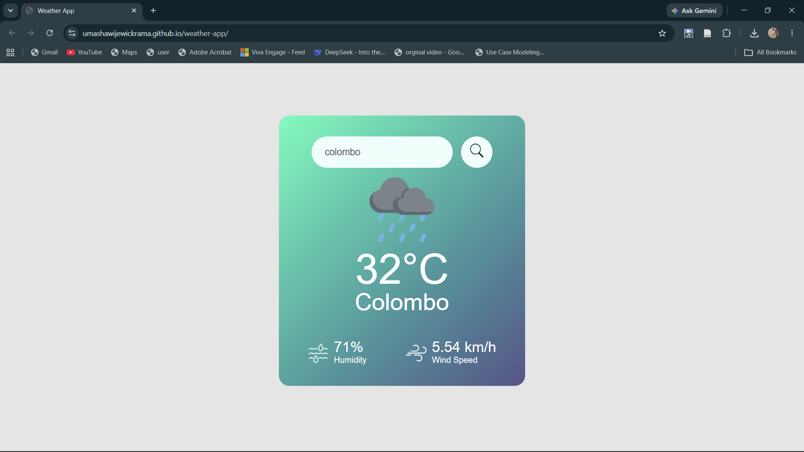

# Weather App

A simple, responsive weather app. Search for any city and instantly see its current temperature, humidity, and wind speed.

## Live Demo

**[https://umashawijewickrama.github.io/weather-app/](https://umashawijewickrama.github.io/weather-app/)**

## Features

- Search weather by city name
- Shows current temperature (°C), humidity (%), and wind speed (km/h)
- Weather icon changes with conditions (e.g. rain)
- "City not found" message for invalid searches
- Responsive layout that works on desktop and mobile

## Built With

- HTML
- CSS
- JavaScript
- Weather API (OpenWeatherMap)

## How to Run Locally

1. Clone the repository:
   ```bash
   git clone https://github.com/umashawijewickrama/weather-app.git
   ```
2. Go into the project folder:
   ```bash
   cd weather-app
   ```
3. Open `index.html` in your browser.

## Project Structure

```
weather-app/
├── index.html
├── style.css
├── script.js
└── images/
```

## Screenshot



## Author

Umasha Wijewickrama